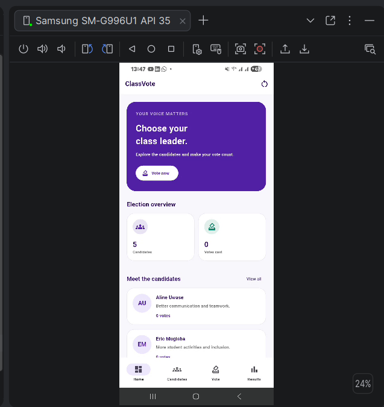
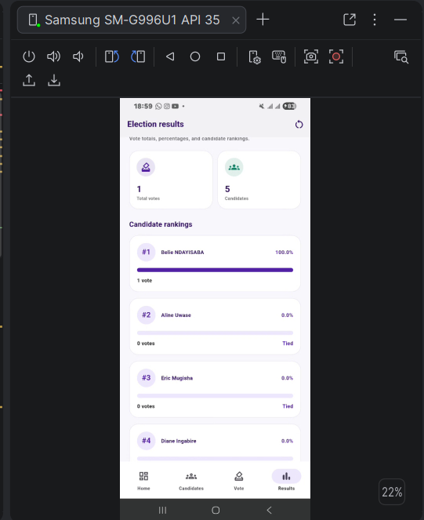
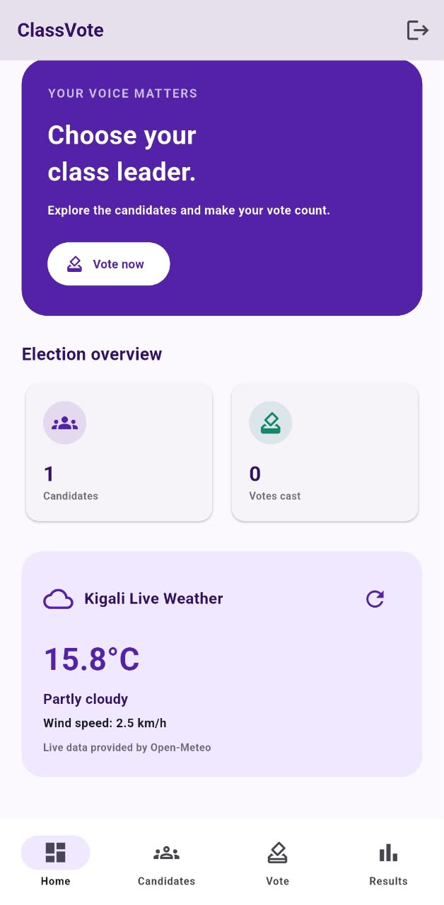
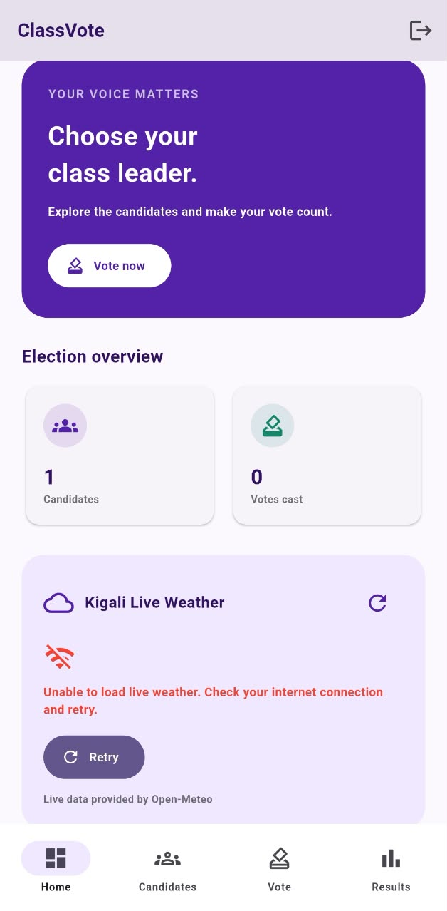
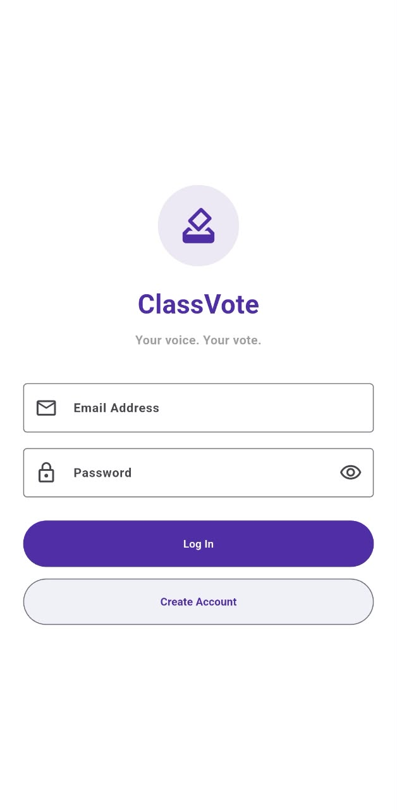
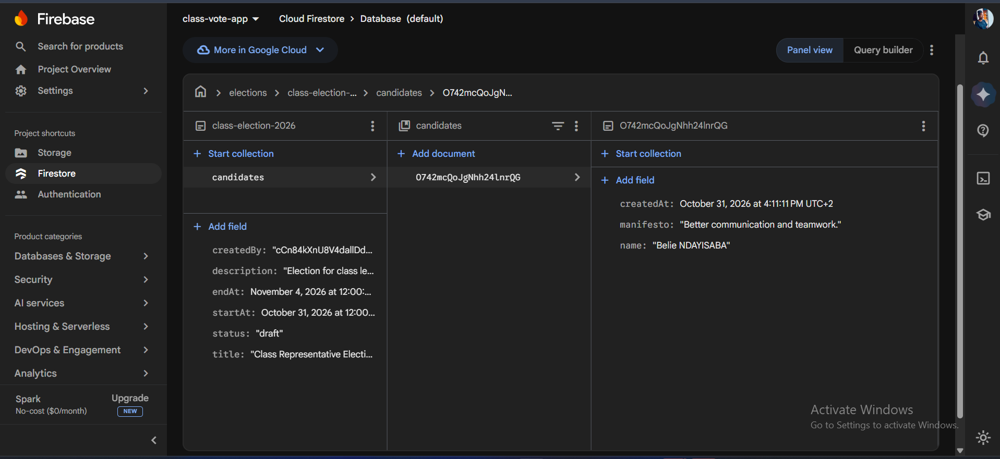
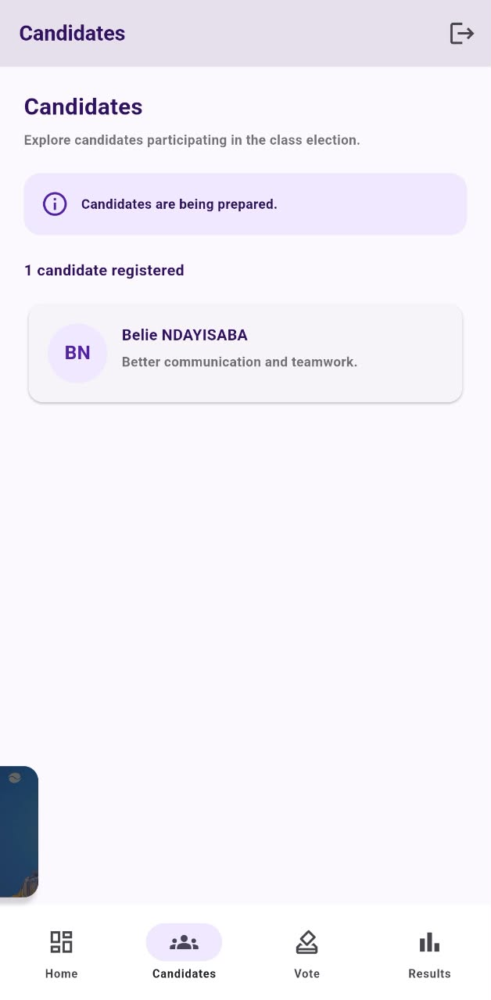
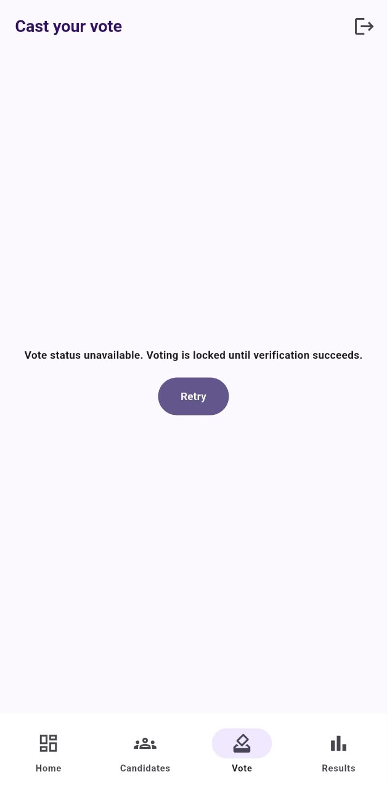

# ClassVote — Flutter Mobile Application

## Project Overview

ClassVote is a Flutter-based student election application designed to help students manage candidates, cast votes, and view election results through a simple mobile interface.

The application uses a deep-purple and white theme and includes four main screens: Dashboard, Candidates, Vote, and Results.

The project began as a local-storage Flutter application and is being extended with Firebase Authentication, Cloud Firestore, and shared election functionality.

## Features

- Dashboard with election statistics and candidate previews
- Candidate registration, editing, and deletion
- Candidate selection and vote confirmation
- Election results with vote totals, percentages, and rankings
- Election reset with confirmation in the original local demonstration
- Local data persistence using `shared_preferences`
- Live Kigali weather using the Open-Meteo API
- Loading indicators, offline error handling, and Retry functionality

### Firebase Integration

The Firebase-enabled version introduces:

- Firebase Authentication for user login
- Authentication-based navigation
- Cloud Firestore for election and candidate records
- Real-time candidate updates using Firestore streams
- Shared election data accessible across authenticated devices, subject to Firestore Security Rules
- Administrator-only candidate management design
- Election states: Draft, Active, and Closed
- One-vote-per-account design using authenticated user IDs
- Cloud Function integration for checking voting status
- Results display after an election closes

**Development status:** Firebase configuration and client-side integration have been added. Security Rules, administrator permissions, Cloud Functions deployment, and end-to-end voting behavior must be verified before treating the shared election system as production-ready.

## Technologies Used

- Flutter and Dart
- Material Design
- `shared_preferences` for local persistence
- `http` for API requests
- Open-Meteo weather API
- Firebase Authentication
- Cloud Firestore
- Firebase Cloud Functions
- Firebase CLI and FlutterFire CLI
- Android Studio
- Visual Studio Code
- Git and GitHub

## Local Data Persistence

ClassVote uses `shared_preferences` to save candidates, vote totals, and voting status on the device in its original local-storage implementation. Saved information remains available after the application is closed and reopened.

This original implementation is a single-device demonstration and is not a secure, multi-user election system.

The Firebase-enabled version introduces a separate cloud-based approach for shared election data. Local storage should not be considered the authoritative source for shared votes.

### Before Closing the Application



### After Reopening the Application



## Live API Integration

The Dashboard retrieves current Kigali weather information from the Open-Meteo API, including temperature, weather conditions, and wind speed.

### Live API Response



### No Internet and Retry

When the weather request fails, ClassVote displays an error message and a Retry button.



## Firebase Authentication

ClassVote uses Firebase Authentication to identify users before allowing them to access the Firebase-connected application.

The authentication flow is managed through an `AuthGate` widget.

- Users who are not signed in are directed to the login screen.
- Authenticated users are directed to the main ClassVote interface.
- Users can sign out of their accounts.

### Login Screen



## Cloud Firestore Integration

Cloud Firestore is used to store shared election information.

The Firebase-enabled ClassVote implementation uses a structure similar to:

```text
elections/
  class-election-2026/
    title
    description
    status
    createdBy
    startAt
    endAt

    candidates/
      candidateId/
        name
        manifesto
        createdAt

    votes/
      userId/
        candidateId
        votedAt

    results/
      candidateId/
        votes

users/
  userId/
    ...
```

Candidate documents can be retrieved through Firestore snapshot listeners, allowing changes to appear without manually restarting the application.

The `votes` collection is designed to use each authenticated user's UID as a vote document ID. Secure enforcement requires appropriate Firestore Security Rules.

### Firestore Console



### Real-Time Firestore Updates

Cloud Firestore snapshot listeners allow the application to respond to changes in stored election data.

For example, when an authorized administrator adds a candidate to Firestore, the candidate list can update automatically on connected clients.



## Authentication and Data Access Testing

Firebase Authentication identifies the signed-in user, while Firestore Security Rules determine which documents that user may read or modify.

For shared elections, students may need access to the same election and candidate records, but should not be allowed to modify other users' votes or access restricted voting information.

The Session 6 assignment also requires demonstrating that a second account cannot access the first account's private data.

This must be verified using genuinely user-owned data and restrictive Firestore Security Rules. A shared candidate list alone does not demonstrate private data isolation.

### Second Account Access Test



## Election Roles and Access Control

The Firebase-enabled version is designed around two main roles.

### Administrator

- Manage candidates during the draft election stage
- Prepare election information
- Manage election operations through authorized backend functionality
- Access administrative features based on verified permissions

### Student Voter

- Sign in using Firebase Authentication
- View available candidates
- Select a candidate
- Submit a vote when the election is active
- View published results when the election closes

Administrator permissions are intended to be enforced through Firebase custom claims and Firestore Security Rules, not only by hiding interface controls.

## Election Workflow

1. An administrator prepares an election.
2. Candidates are registered while the election is in Draft status.
3. The election becomes Active.
4. Authenticated students select and confirm their votes.
5. The backend validates voting eligibility and prevents duplicate voting.
6. The election closes.
7. Verified results become available for viewing.

Some backend operations require Cloud Functions and security configuration before this workflow can be considered fully operational.

## Screenshots

### Original Flutter Application

The original project screenshots demonstrate local persistence, API integration, and offline error handling.

| Feature | Screenshot                    |
|---|-------------------------------|
| Before closing | `lib/screenshots/before.png`  |
| After reopening | `lib/screenshots/after.png`   |
| Live weather API | `screenshots/api.png`         |
| No internet | `screenshots/no-internet.png` |

### Session 6 — Firebase Integration

| Requirement | Screenshot |
|---|---|
| Firebase login | `screenshots/login.png` |
| Firestore collection and documents | `screenshots/console.png` |
| Real-time Firestore update | `screenshots/live.png` |
| Second account data isolation | `screenshots/denied.png` |

These screenshots should be captured from the actual running application and Firebase Console.

## How to Run

### Prerequisites

- Flutter SDK
- Dart SDK
- Android Studio or Visual Studio Code
- Google Chrome or an Android device
- Firebase project configuration
- Internet connection for Firebase and weather services

### Clone the Repository

```bash
git clone https://github.com/NKBelie/Class_Vote_App.git
cd Class_Vote_App
```

### Install Dependencies

```bash
flutter pub get
```

### Check Available Devices

```bash
flutter devices
```

### Run on Android

```bash
flutter run
```

### Run on Google Chrome

```bash
flutter run -d chrome
```

### Firebase Configuration

The project uses the FlutterFire-generated `lib/firebase_options.dart` file.

If configuring Firebase for a new project, use the FlutterFire CLI to generate the appropriate platform options.

```bash
flutterfire configure --project=class-vote-app-1004c --platforms=android,web
```

Firebase Authentication providers, Firestore Security Rules, and any required Cloud Functions must also be configured in Firebase.

## Project Structure

```text
lib/
  main.dart
  auth_gate.dart
  login_screen.dart
  firebase_options.dart

  models/
    candidate.dart

  screens/
    home_screen.dart
    dashboard_screen.dart
    candidates_screen.dart
    voting_screen.dart
    results_screen.dart

  services/
    candidate_service.dart
    election_service.dart
    election_storage.dart

  widgets/
    candidate_card.dart

  theme/
    app_theme.dart

screenshots/
  login.png
  console.png
  live.png
  denied.png
```

## Project Purpose

This project demonstrates Flutter UI development, navigation, state management, local persistence, REST API integration, error handling, Firebase Authentication, Cloud Firestore integration, and real-time data synchronization for a Mobile Programming assignment.

It also explores how a simple local voting application can evolve into a cloud-connected election management system.

## Future Improvements

- Complete and verify secure shared voting
- Deploy and test the required Firebase Cloud Functions
- Finalize role-based access control
- Verify Firestore Security Rules using multiple accounts
- Improve election lifecycle management
- Add automated tests for voting restrictions
- Improve responsive layouts for web and mobile
- Add clearer loading, success, and failure states

## Repository

[ClassVote — GitHub Repository](https://github.com/NKBelie/Class_Vote_App.git)

---

**ClassVote — A Flutter Mobile Programming Project**
